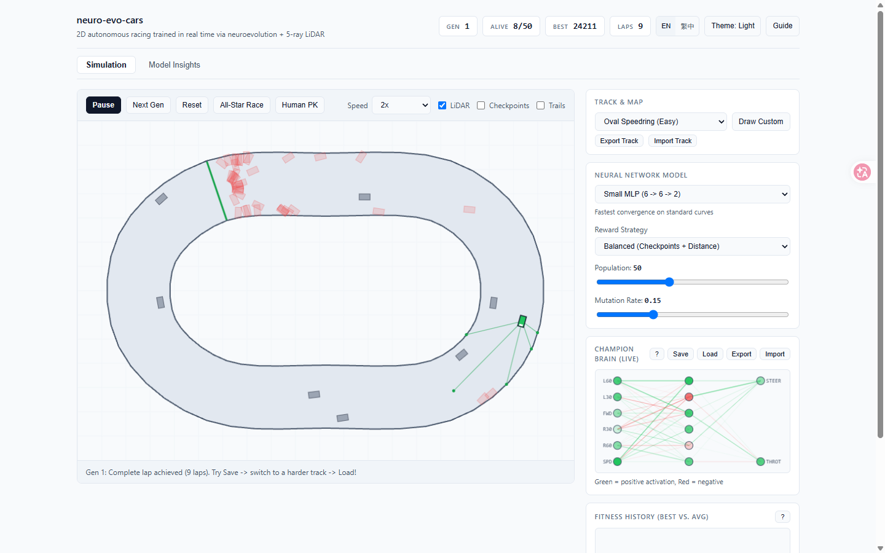

# neuro-evo-cars

Zero-dependency 2D autonomous racing sandbox trained in real time via neuroevolution and 5-ray LiDAR sensors. Runs directly in any browser (`index.html`), with full `EN / 繁中` bilingual UI and Light/Dark themes.



## Features

- **7 Built-In Tracks + Custom Track Drawing & JSON I/O (`js/tracks.js`)**:
  - `Oval Speedring`, `Kidney Sweeper`, `S-Curve Circuit`, `Double Chicane GP`, `Hairpin Chicane`, `Technical Apex Loop`, and `Narrow Canyon` generated via closed Catmull-Rom splines.
  - **Draw Custom** directly on the canvas, or **Export / Import Track** as `.json`.
- **5 Neural Network Architectures (`js/nn.js`)**:
  - `Linear Perceptron (6 -> 2)` (no hidden layer baseline)
  - `Small MLP (6 -> 6 -> 2)` (tanh)
  - `Wide ReLU MLP (6 -> 12 -> 2)` (ReLU)
  - `Deep MLP (6 -> 10 -> 6 -> 2)` (2-layer tanh)
  - `Memory RNN (6+2 -> 8 -> 2)` (recurrent previous-action context)
- **Simulation Modes & Reward Shaping (`js/car.js`, `js/app.js`, `js/visualizer.js`)**:
  - **Reward Strategy**: Switch between `Balanced`, `Speed Focus`, and `Smooth Apex` (penalizes steering oscillation).
  - **All-Star Race**: Pit all 5 trained model champions against each other live on the same track.
  - **Human PK**: Drive a cyan car with `WASD` / Arrow keys alongside the AI.
  - **Trails & Crash Heatmap**: Visualize the champion's racing line (green = throttle, red = brake) and population crash hotspots.
- **Model Insights & Web Worker Benchmark (`js/bench-worker.js`)**:
  - **Head-to-Head 5-Model Benchmark**: Train all 5 models side-by-side (8 / 20 / 40 generations) in a background Web Worker with live learning curves.
  - **Interactive Decision Probe**: Test synthetic scenarios or drag all 6 sensor sliders (`L60`, `L30`, `FWD`, `R30`, `R60`, `SPD`) to compare all 5 models' steering & throttle responses.
  - **Cross-Track Generalization Test**: Evaluate any trained champion across all 7 preset tracks in one click.
  - **Brain Persistence**: `Save / Load` via `localStorage` plus `.json` `Export / Import`.

## Usage

Open `index.html` in a modern browser (or serve locally for Web Worker support), or run the Node.js benchmark:

```bash
node scripts/benchmark.js
```

## Sample Benchmark (10 Generations, Pop 24, `balanced` reward)

| Track | `mlp_tiny` | `mlp_small` | `mlp_wide` | `mlp_deep` | `rnn_memory` |
|---|---:|---:|---:|---:|---:|
| `oval` | 4118 (1L) | 4218 (1L) | 4218 (1L) | 4216 (1L) | 4118 (1L) |
| `scurve` | 1659 (0L) | 1348 (0L) | 1859 (0L) | 1547 (0L) | 1860 (0L) |
| `hairpin` | 1980 (0L) | 1662 (0L) | 2499 (0L) | 3112 (1L) | 1984 (0L) |
| `technical` | 1246 (0L) | 1246 (0L) | 1344 (0L) | 1345 (0L) | 1451 (0L) |
| `kidney` | 3818 (1L) | 4018 (1L) | 3918 (1L) | 3918 (1L) | 4018 (1L) |
| `monza` | 1236 (0L) | 4418 (1L) | 4418 (1L) | 4418 (1L) | 4418 (1L) |
| `spiral` | 1563 (0L) | 1455 (0L) | 835 (0L) | 1561 (0L) | 1559 (0L) |
